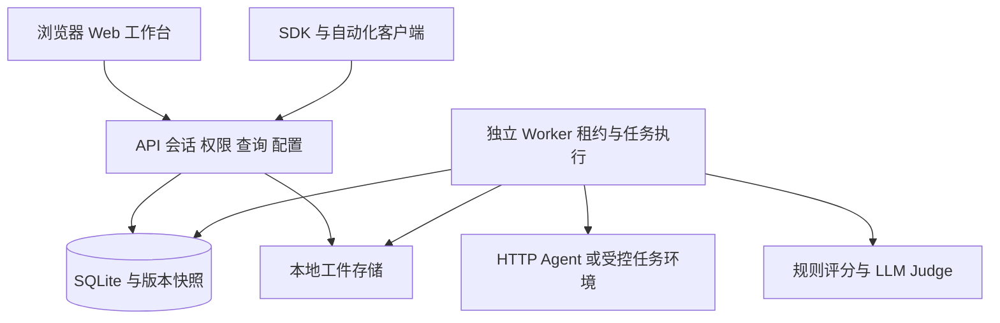

# LiteEval 系统改进与实施方案

方案版本 1.0 ｜ 2026年11月1日 ｜ 基于后端 0.2.0 的产品化改造

建议保留现有评测执行核心，围绕浏览器使用补齐身份、查询、配置、进度和证据展示，再建设质量标准、人工复核和验收 Gate。首期继续采用单机 SQLite 与本地工件，优先把真实 HTTP Agent 的业务闭环交付完整。

本方案与 [产品需求文档](liteeval-prd-v1.0.md) 配套：PRD 定义用户行为和验收口径，本方案定义模块改造、接口、数据迁移、任务依赖和工程验证。以下技术选型、工作量和阈值均为建议，开发时应固定依赖并用实测确认。

## 1 建设判断与关键决策

### 1.1 当前基础可以保留

现有 core、storage、runner、adapters、evaluators、reports、sdk、process 和 environments 已覆盖数据契约、快照、并发执行、恢复、评分与对比。缺口集中在 Web 产品、面向页面的查询、版本管理体验以及正式运行保障。

本次工作不应重写一套 Worker，也不应为实现 Dashboard 提前引入 PostgreSQL、Redis 和对象存储。已有租约、幂等、Attempt 历史、严格 Compare 和缺失证据处理是后续必须保留的行为约束。

### 1.2 建议决策表

| 主题 | M1 建议 | 选择理由 | 后续触发条件 |
| --- | --- | --- | --- |
| 前端 | React、TypeScript、Vite、Ant Design | 表格、复杂表单和详情面板可复用，适合评测工作台 | 出现明确业务体验缺口后再评估替换 |
| API 服务 | 引入 FastAPI 与 Pydantic，逐路由迁移 | 补充契约校验、OpenAPI 和会话入口 | 保留 /v1；不在一次发布中改变所有语义 |
| 服务端执行 | 保留独立 Worker 与现有 Runner | 长任务不占用页面请求，复用恢复机制 | 队列等待和锁竞争达到实测瓶颈后扩展 |
| 数据 | SQLite WAL，本机 SSD | 符合个人和小团队自托管规模 | 多机 Worker 或持续写锁竞争时评估 PostgreSQL |
| 工件 | 本地目录与元数据引用 | 复用现有 hash 校验和项目权限 | 备份体积、跨机读取或容量要求出现后评估对象存储 |
| 进度 | 轻量轮询摘要 | 实现和恢复路径简单 | 大量并发浏览器需要时再引入 SSE |
| 身份 | 单人 Owner 服务端会话 | 浏览器无需持有管理员 API Token | P1 加入项目成员与细粒度权限 |
| 验收范围 | HTTP 真实闭环优先 | 可尽早验证产品价值 | Codex/Docker 按正式支持范围单独验收 |

React 与 Ant Design 的组件能力、FastAPI 的 OpenAPI 和类型校验能力见文末官方文档。选型是否满足具体性能目标仍需本项目实测。

## 2 差距与改造清单

| 领域 | 现有实现 | 需要改进 | 优先级 |
| --- | --- | --- | --- |
| 身份 | 管理员/项目 Bearer Token | Owner 会话、CSRF、退出与撤销；P1 成员权限 | P0/P1 |
| 项目总览 | 实验级 summary | 时间范围、生产/Eval 分离、基线选择与聚合查询 | P0 |
| Trace | JSON 事件、基本列表 | 时间/版本/摘要检索、摘要字段、事件按需读取与可视化 | P0 |
| Dataset | 创建、修订、导入、JSON 导出 | 更新/归档、并发编辑冲突、CSV 导出、导入预览 | P0 |
| 评分器 | 独立不可变 revision 记录 | 稳定实体、修订列表、归档、表单与评分预览 | P0 |
| 实验 | 创建、执行、结果与 Compare | 名称、预检、轻量进度、分页 Run、按需工件、列表筛选 | P0 |
| 配置 | Worker 环境变量引用 | 凭据就绪摘要、Agent 版本与接入向导 | P0 |
| 恢复 | 租约与心跳 | Worker 在线表、运行诊断、可观察的取消与接管 | P0 |
| 质量标准 | 单实验评分器集合 | Eval Spec、发布集、人工记录、Gate Policy 与报告 | P1 |
| 长期使用 | 手工备份说明 | 审计、备份恢复工具、工件留存与保留引用 | P1 |
| 高级评测 | 文本/JSON/工具/文件规则 | 框架 Adapter、OTel、复杂轨迹、多模态和统计分析 | P2 |

## 3 目标架构与模块边界

### 3.1 单机产品化架构



开发环境用前端代理把 /v1 转发至 API；正式单机部署通过同源反向代理提供静态资源和 API。API 默认继续监听 loopback，远程访问由部署代理提供 TLS、大小限制与访问控制。

M1 的 Web 服务可增加静态页面入口，但长任务必须进入原有持久队列。禁止用 Web 进程内 background task 代替独立 Worker 执行实验。

### 3.2 建议目录

```text
frontend/                 页面 路由 类型化客户端 组件
liteeval/webapi/           FastAPI 路由 会话 请求响应模型
liteeval/services/         预检 预览 版本发布 Gate 应用服务
liteeval/repositories/     新查询与存储边界 逐步拆分 Store
liteeval/core.py           现有评测契约
liteeval/runner.py         现有租约 并发 重试 恢复
liteeval/adapters.py       HTTP 接入
liteeval/evaluators.py     评分执行
liteeval/reports.py        统一指标与 Compare
docs/product/             PRD 实施方案 验收与接口增量
```

目录拆分随业务增量进行，不要求先做一次全面重构。新的页面查询不能复制另一份 success_rate 或 Compare 算法；汇总服务复用 reports 的语义，增加聚合时为每个指标提供样本数和覆盖率。

### 3.3 页面与数据分层

Overview 使用独立聚合端点；Trace 列表只返回摘要，详情才加载输入输出，事件面板再读取事件；实验列表和进度只读状态与计数；结果表分页读取 Run；原始响应、文件、patch 按需下载。前端禁止加载全部历史数据再在浏览器计算仪表盘。

初期 polling 约 2 秒，页面失焦逐步退避，实验终结后停止。查询缓存 key 至少包含 project_id、资源、筛选和分页；退出或切换用户时清除会话级缓存。

## 4 数据结构与迁移

### 4.1 P0 增量数据

| 结构 | 建议新增字段或记录 | 规则 |
| --- | --- | --- |
| projects/datasets | description、updated_at、archived_at | 归档只影响新选择，不破坏历史外键 |
| cases | archived_at、updated_at | input/expected 与评测标签仍进入 case_revisions |
| Case 内容 | metadata.title/tags/priority/critical | critical 默认 false；值域校验；旧 metadata 原样保留 |
| Agent 版本 | 稳定 agent_id、版本说明、external_revision、created_at | 已有 config_hash 和执行配置保持不可变 |
| Evaluator | evaluator 实体与 revision 编号 | 旧 revision 每条映射为独立实体，不按重名自动合并 |
| experiments | name、description、updated_at、diagnostic、spec_revision_id 可空 | 旧实验 diagnostic 默认 false，spec 为空不适用 Gate |
| traces | 可检索摘要、Agent 标识、latency、usage、cost 与覆盖标记 | 从显式 metadata 派生；缺失保持 NULL |
| users/sessions | Owner、密码哈希、会话 token_hash、expiry、revoked_at | 不存明文密码或会话 token |
| worker_registry | worker_id、heartbeat_at、支持 Adapter、配置就绪摘要 | 不保存或返回凭据值；管理员可见变量名 |
| diagnostic_jobs | 类型、项目、配置 hash、输入引用、状态、租约、结果工件、过期时间 | 仅受控预览与试运行，复用租约工具，不接受任意命令 |
| audit_events | 操作者、项目、action、resource、时间、请求 ID | 不记录原始密钥、完整业务输入或响应 |

现有 project api_keys 与浏览器 session 分离。Worker 直接访问本机数据库写心跳，capability 状态只能供已授权管理入口读取；普通项目用户不能枚举主机全部环境变量。

### 4.2 P1 质量管理对象

| 对象 | 关键字段 | 约束 |
| --- | --- | --- |
| dataset_versions | dataset_id、name、snapshot_id、说明、published_at | 名称在 Dataset 内唯一，发布后不改内容 |
| eval_spec_revisions | project_id、snapshot_id、evaluator_ids、critical_set、applicability、policy_revision_id、hash | 固定实际 Case 集合与规则，不依赖可变标签查询 |
| review_assignments/annotations | run_id、维度、reviewer、规范版本、结论、理由、版本 | 保留历次标注及冲突，不改机器评分 |
| scoring_sessions | output_source_run_id、evaluator_revision_ids、状态、hash | 与新 Agent 运行明确区分 |
| gate_policy_revisions | 规则、阈值、最小样本、证据要求、hash | 校验通过才可发布 |
| gate_reports | experiment_id、spec/policy 修订、baseline_id、结论、counts、evidence、hash | 同一输入集合幂等，历史不可覆盖 |
| memberships | user_id、project_id、role | 后端强制执行角色权限 |

数据库迁移采用明确的 schema v3、v4 等增量步骤，与软件包版本分开。迁移脚本先检查当前 schema，在事务中创建表和索引、回填可推导字段，再更新 user_version。工件内容不在迁移时批量重写。

### 4.3 快照与编辑冲突

Case 更新请求必须带 base_revision；事务中检查当前 revision，一致才写新修订，否则返回 409。Case 归档不删除旧修订。冻结快照时只读取有效 Case；历史 rerun 使用原 snapshot_cases，不应用当前归档状态。

兼容窗口内，旧 /v1 客户端未传 base_revision 时仍按原有新增修订行为处理，并提供迁移提示；新网页和新版 SDK 必须携带该字段。下一次不兼容 API 版本才可统一改为必填，不能在小版本升级中静默破坏旧客户端。

新建实验的数据来源为三选一：当前 Dataset、已发布 Dataset Version 或历史实验 rerun。旧客户端仍使用 dataset_id；新 API 对来源互斥校验，防止同时指定两个不一致的来源。所有资源都校验同一 Project。

### 4.4 查询与索引

增加 traces(project_id, kind, created_at, id)、experiments(project_id, status, created_at, id)、cases(dataset_id, archived_at)、artifacts(project_id, run_id) 等与实际查询相符的索引。排序以时间与 ID 组合保证稳定，现有旧 API 的默认顺序保持兼容，新页面显式指定 sort。

首期摘要检索采用受限长度的索引字段和参数化查询，不对整块 JSON 进行无限制全文扫描。事件列表可先从既有 events_json 分页解析；当单 Trace 大事件量明显影响延迟时，再引入规范化 Event 表或分块工件，保持原始 JSONL 引用。

## 5 API 增量契约

### 5.1 兼容原则

保留现有 /v1/health、projects、traces、datasets、experiments、compare、runs 和 artifacts 的公开语义。通过 FastAPI 迁移的路由需要与旧 dispatch 做契约对照，包括状态码、项目隔离、幂等冲突与错误结构。旧 API Token 与新 Cookie 会话都经同一 Principal 和 scope 检查。

下表是建议新增或增强的接口，尚未实现。每个写接口必须定义项目作用域、角色、字段校验、幂等或冲突行为和审计记录。

### 5.2 P0 接口清单

| 方法与路径 | 用途 | 主要约束 |
| --- | --- | --- |
| POST /v1/auth/session | 建立 Owner 会话 | 登录限速；返回 Cookie，不返回管理员 Token |
| GET /v1/auth/me | 当前用户与项目权限 | 不回显凭据 |
| DELETE /v1/auth/session | 撤销当前会话 | 写入撤销状态，Cookie 失效 |
| GET /v1/projects/{id}/overview | 项目总览聚合 | time range、kind、baseline；返回计数与分母 |
| PATCH /v1/projects/{id} | 项目信息 | Owner 权限，不修改历史评测配置 |
| GET /v1/traces | 增强列表筛选 | time、version、tag、q；摘要分页 |
| GET /v1/traces/{id}/events | 按需读取事件 | project scope、limit、offset；返回完整性标记 |
| PATCH /v1/datasets/{id} | 名称、说明与归档 | 归档阻止新提交，不破坏历史 |
| POST /v1/datasets/{id}/import-preview | 仅校验与预览 | 无入库；行号、错误、规范化计数 |
| GET /v1/datasets/{id}/export | 增加 format=json/csv | JSON 默认保持兼容；CSV 正确转义 |
| POST /v1/cases/{id}/revisions | 增加 base_revision | 旧客户端迁移策略明确；新网页必填 |
| PATCH /v1/cases/{id} | 归档状态 | 审计并保留旧 revision |
| POST /v1/evaluators/{id}/revisions | 新建修订 | 返回新 revision ID，旧实验不变 |
| POST /v1/evaluator-previews | 一次规则或 Judge 预览 | 显式触发；管理员可信配置；受 Worker 执行 |
| POST /v1/experiments/preflight | 检查配置与证据 | 不自动调用 Agent，返回阻塞项和警告 |
| GET /v1/experiments/{id}/progress | 轻量进度摘要 | 不返回 output、events 和全部 scores |
| GET /v1/experiments/{id}/runs | 结果列表分页 | outcome/status/category 筛选 |
| GET /v1/runtime/status | Worker/配置状态 | 受权限控制，禁止凭据泄露 |

评分预览、Agent 连接测试等外部调用按需复用一类受控诊断任务，单独返回 task_id，设置超时、上限和鉴权；不复用用户自由命令，不占用 API 请求执行长时间模型任务。

### 5.3 示例响应

进度接口示例中的总数来自冻结快照，terminal 是已经终结的 Run，不等于通过数。取消中的用户可见状态由 experiment status 与 cancel_requested 推导，不更改旧状态机取值。

```json
{
  "experiment_id": "exp_example",
  "status": "running",
  "cancel_requested": false,
  "counts": {
    "total": 100,
    "terminal": 40,
    "running": 4,
    "pending": 56,
    "succeeded": 35,
    "failed": 3,
    "timed_out": 2,
    "cancelled": 0
  },
  "updated_at": "2026-11-01T02:00:00Z",
  "worker_state": "active"
}
```

预检返回 blocking_errors、warnings、evidence_coverage、credential_readiness 和 estimated_call_count；费用未知时为 null，并说明没有价格依据。提交将预检所依据的配置哈希带回，配置变化时重新预检。预检不是对外部服务实时可用性的保证。

### 5.4 P1 接口

新增 Dataset Version 发布/读取、Eval Spec 修订发布、人工分派与标注、Scoring Session、Gate Policy 修订、Gate Report 生成/读取、基线选择和成员权限接口。报告生成接受明确的 experiment_id、spec_revision_id 与 baseline_id，不能隐式采用“最新策略”替代已冻结口径。

CI 客户端只使用受限项目密钥创建实验、轮询结果与读取 Gate。CLI 建议用 0 表示 PASS、2 表示 BLOCKED、3 表示等待超时或服务错误，并在 JSON 中保留原因；流水线只能将明确 PASS 作为质量成功。

## 6 评分与 Gate 实现要点

### 6.1 统一口径

继续保留 reports.py 的 case_outcome 与现有 summary 字段，不在前端重新实现判断。增加 metrics_version 与 denominator/sample_count/coverage 元数据。兼容期新增字段，不重新解释旧字段。

Gate 不直接拿 metrics[].pass_rate 当任务或工具完整通过率，因为现有分母仅包含有效 pass/fail。Task Success 必须在 Spec 中映射到具体任务评分器，不能用 Run succeeded 或全部规则通过率代替。Gate 应基于 Spec 中冻结的必需集合计算，Agent 执行失败、abstain、error 均不能从分母移走。只有预先确定的 non-applicable 项才可排除。

### 6.2 Gate 执行顺序

1. 校验实验、Spec、Policy、权限与引用完整性，确认不是诊断运行。
2. 检查实验已 completed，所有必需执行与评分结果可用；failed/cancelled 或缺失结果产生 BLOCKED。
3. 冻结并核对必需 Case、critical 子集及各指标适用集；检查最小样本、覆盖率与要求的人工记录。
4. 若策略要求回归，检查基线可比较；需要性能比较时额外核对环境、并发、资源与耗时口径。
5. 逐条件计算 actual、threshold、numerator、denominator 与证据，任一条件不满足即 BLOCKED。
6. 持久化不可变 Gate Report；重复输入按 report key 返回原结果。

质量比较和性能比较分开给出可比状态。Agent 版本是期望变化项，不能因为 Agent config_hash 不同就拒绝比较；判断应对准 Case、Evaluator、采样设置和运行环境等受控条件。

### 6.3 人工评测与 Judge 校准

人工标注采用可追溯的 Annotation 记录；审核人员不能直接修改 Run 或 Score。校准集按 Case 或任务来源划分，避免同一来源重复样本同时出现在校准和验收集合。对二值指标记录一致率与分歧类型；是否引入 Cohen kappa 等统计量由样本与标注设计决定。

小样本上先验证 Judge 输入、输出尺度、阈值、理由和错误分类，再扩大调用量。幻觉模板必须关联可核查参考证据；发生评分配置变更后，新建评分修订和 Session，保持原始机器结果。

### 6.4 成本与预算

P0 展示最终 Run 与所有 Agent Attempt 的已上报成本，附币种和覆盖率；Judge 原始响应独立留档，不混入 Agent 成本。P1 增加统一 CostObservation，记录 source_type、usage、currency、amount 和价格版本，才能支持含 Judge 的总成本。

调用前预算只能估算：输出 token 和重试次数存在不确定性。预算阈值达到后停止调度新调用，并保存已知消费；不能保证已经在途的外部请求不再产生费用。缺少定价或 usage 时明确显示未知，不自动填零。

## 7 安全与执行边界

浏览器登录采用密码哈希和服务端随机会话，Cookie 设 HttpOnly、SameSite，HTTPS 时设 Secure；状态变更请求验证 CSRF 与 Origin。默认建议空闲 8 小时、最长 7 天过期，具体值可由部署者调整。登录失败限速，默认 Owner 凭据由部署时生成，不写入前端构建产物。

Agent/Judge endpoint、环境变量引用、Codex 镜像与验证命令仅由 Owner 或受授权配置者维护。内网服务接入可以是业务需要；部署管理员应能明确配置允许访问的目标范围，禁止由 Case 输入决定任意 endpoint 或挂载路径。

现有工作目录提供任务文件隔离。Docker 增强进程与资源约束，但实际内核、网络、镜像和 CLI 沙箱仍需实测。真实 Codex 子进程、认证、JSONL 兼容和后代进程清理各自记录验收结果，不能根据单个 parser 测试推断整体可用。

原始输出可能包含敏感信息。结构化凭据脱敏继续保留；新增工件预览以文本、安全 MIME 和下载为主，禁止执行上传 HTML。审计保留动作摘要与资源 ID，不复制所有原始业务内容。

## 8 分阶段实施与任务依赖

### 8.1 M1 Web 回归工作台

| 工作包 | 交付物 | 前置依赖 | 对应需求 |
| --- | --- | --- | --- |
| W01 基线稳定 | Windows 两项问题分类修复；Linux 基线；契约清单 | 当前代码 | AC 02、12、22 的基础 |
| W02 API 与会话 | FastAPI 入口、Principal、会话、OpenAPI、迁移框架 | W01 | ST 01、03 |
| W03 前端骨架 | 六导航、Project 上下文、错误/空/加载状态、类型客户端 | W02 契约 | 通用交互 |
| W04 数据管理 | Dataset/Case UI、预览、CSV 导出、归档、编辑冲突 | W02/W03 | DS 01–05 |
| W05 Agent 与评分器 | Agent 版本、凭据状态、12 类表单、预览任务 | W02/W03 | EV 01–04、ST 02 |
| W06 Trace 分析 | 摘要查询、事件树、时间轴、转 Case | W04 | TR 01–04 |
| W07 实验闭环 | 预检、幂等、进度、Run/Attempt/工件、取消与重跑 | W04/W05 | EX 01–07 |
| W08 Compare 与总览 | 严格配对、输出并排、指标差值、项目总览 | W06/W07 | EX 08–09、OV 01–04 |
| W09 真实接入验收 | 真实业务 Agent、脱敏 Demo、安装与使用文档 | W08 | 全部 P0 AC |

建议的先行纵向切片是“登录 → Project → 导入 2 条 Case → exact_match → HTTP 实验 → 结果 → 新版本重跑 → Compare”。切片完成后再扩展 Trace 可视化、完整评分表单和 Overview，降低页面与接口分离开发的返工。

### 8.2 M2 质量验收工作流

| 工作包 | 交付物 | 依赖与验收 |
| --- | --- | --- |
| W10 数据集发布与 Spec | 命名不可变版本、Spec 修订、critical 与适用集冻结 | 依赖 W04/W07，修改草稿不改变已发布标准 |
| W11 人工复核与校准 | 标注记录、分歧视图、Judge 校准集 | 依赖 W07，机器与人工结果都可追溯 |
| W12 Gate 与 CI | Policy 修订、报告、阻断理由、CI 客户端 | 依赖 W10，要求复核时依赖 W11；缺证据不 PASS |
| W13 成员与审计 | 项目角色、服务端授权、审计查询 | 依赖会话与资源作用域；跨项目负例验收 |

### 8.3 M3 与 M4 运行验收及正式发布

根据正式支持范围完成真实 Judge、Codex 和 Docker 验收，补齐备份还原工具、迁移回退方案、日志、Worker 心跳、队列等待与磁盘容量监控。先实现项目内运行告警记录，再按明确需求接入通知渠道，避免平台默认向外发送业务信息。

M4 发布条件是选定 P1 和所有 P0 验收通过，真实业务回归集有结果，安装升级可复现，敏感字段与鉴权负例通过，恢复演练有记录。P2 高级评测不自动成为正式版发布门槛。

### 8.4 工作量与排期方法

| 阶段 | 建议工程工作量 | 包含内容 |
| --- | --- | --- |
| M1 | 25–40 人日 | 前后端、契约、核心交互、Windows/Linux 回归与真实接入 |
| M2 | 20–35 人日 | Spec、人工记录、Gate、CI、成员与权限测试 |
| M3/M4 | 15–25 人日 | 目标环境、运行工具、备份恢复和发布验收 |
| 合计 | 60–100 人日 | 不含大规模多模态、SaaS、多机队列与复杂框架接入 |

以上按一名熟悉 Python 与 Web 的全栈工程师承担实现和常规测试粗估，不是交付承诺，也不是单纯代码生成时间。可预留约 20% 集成与外部依赖缓冲。详细交互设计、账号凭据、业务标注与目标部署环境应在相应阶段前就绪；并行投入不能线性缩短依赖链。

## 9 验证方案与发布保障

### 9.1 自动化分层

- 保留现有 28 项行为测试，针对 Windows 替身脚本改为明确的跨平台测试入口；符号链接权限不足时记录有原因的跳过，并在具备权限的 Linux 环境强制运行防护测试。跳过不能标记为防护验收通过。
- API 契约测试覆盖旧 /v1、Cookie/API Key 双身份、作用域、409 冲突、分页与字段校验。替换路由时以同输入对照旧行为，允许变化必须写入兼容说明。
- 对 Gate、Case 冲突、快照归档、评分分母和重评分保留编写必要单元/集成测试；避免只验证实现细节而没有业务断言。
- 使用浏览器端到端测试覆盖首次接入、Trace 转 Case、导入错误、实验/取消/重跑/Compare、越权和 Gate 缺证据。模型调用使用可控服务做自动化，真实供应商验收单独记录。
- 用目标硬件验证 1000 Case 实验和 10000 Trace 查询；分别报告 API、存储、外部 Agent、Judge 的耗时，不把模拟调用吞吐包装成真实模型性能。

### 9.2 异常与恢复矩阵

| 故障 | 验证方法 | 通过标准 |
| --- | --- | --- |
| 提交响应丢失 | 同一 key 重发 | 只有一个实验 |
| Agent 429/5xx/超时 | 可控服务注入 | 按策略重试，稳定 Run 幂等键，成本留痕 |
| Judge 非法输出 | 注入错误 JSON | 独立重试、原始回复留档、Agent 不重跑 |
| Worker 被强制终止 | 运行中结束 Worker | 租约后接管，已提交 Run 不重跑 |
| 取消与旧 Worker 返回竞争 | 延迟返回并触发取消 | 旧结果不能覆盖终态 |
| API 重启 | 执行中重启 API | Worker 继续，页面重新连接可读 |
| 磁盘不足或工件损坏 | 测试目录模拟失败 | 明确失败，不产生可验证成功假象 |
| 备份还原 | 迁移到独立目录启动 | 元数据、hash、工件、历史 Compare 一致 |
| 升级中断 | 迁移故障注入 | 事务回滚或通过备份恢复，不混跑旧 schema |

### 9.3 发布顺序

停止旧 API 与 Worker，创建数据库和工件一致备份，记录旧程序与 schema 版本，执行迁移，启动 API 并校验 schema，再启动新版 Worker，完成健康检查和少量本地确定性 Case。确认通过后开放 Web 访问。

回退不能只替换旧二进制继续读取新 schema。没有向下兼容时，应停止新版、保全新增数据，再恢复升级前备份和旧版本。正式运行恢复点与备份频率由实际数据价值确定。

建议保留每日自动备份并定期演练；具体 RPO/RTO 不能仅从频率推断。可先设验收目标：最近一次成功备份内的数据能恢复，500 MB 数据及工件基准在 30 分钟内完成还原，实际值以目标环境演练记录为准。

## 10 主要风险与处置

| 风险 | 影响 | 处置 |
| --- | --- | --- |
| 首期范围过宽 | Web 迟迟无法交付 | 以 HTTP 纵向闭环和 P0 AC 控制范围 |
| 单次 Judge 波动 | 候选版本被误判 | 校准、固定配置、保留理由；P2 再增加重复采样和统计分析 |
| 多测试集分数混合 | Overview 或 Gate 结论失真 | 基线按 Spec/快照分组，显示分母和适用集 |
| API 迁移改变语义 | 旧 SDK/CLI 失效 | 保留 /v1 合同与对照测试，逐路由切换 |
| 自动归档或清理破坏证据 | 历史报告不可验证 | 引用保留、删除预演、审计和一致备份 |
| 外部 Agent 有副作用 | 重试产生重复操作 | 稳定幂等键、接入检查；优先隔离测试环境 |
| SQLite 写入压力 | 页面和 Worker 相互影响 | 短事务、索引、按需查询；达到触发条件再迁移 |
| 平台兼容被过度承诺 | Codex/Docker 在用户环境失败 | 按平台记录真实验收、替身测试与跳过项 |

## 11 后续扩展的触发条件

当 SQLite 在目标负载下持续出现锁等待，或要求跨主机 Worker 时，先抽象 Repository 和租约存储，再迁移 PostgreSQL；现有文件不能放在网络共享盘上作为多机队列。只有任务需要跨主机投递、背压与独立服务隔离时才引入消息队列，数据库仍作为任务与结果事实来源。

当工件占用、恢复耗时或跨机访问超出单机目标时，引入 Storage Backend 接口及对象存储，保留 artifact_id、hash 与鉴权，不暴露公共桶 URL。OTel 接入应定义事件映射、采集完整性、重复去重和语义版本；已有 SDK 保留兼容。

复杂轨迹与多模态评测先选择一个具体业务场景，定义可验证的证据、标注集和评分器，再增加平台能力。需求定义与 Eval Spec 可逐步完善，生产监控优先围绕已验收的质量指标，不把日志成功率等同于业务质量。

## 12 开发启动建议

第一批实施任务为 W01–W03 和最小纵向切片：固定当前行为、修复测试入口兼容、确定 API 模型、建立会话与前端骨架，跑通少量真实 HTTP Case 的新旧版本 Compare。之后按数据管理、评分配置、Trace 分析与总览逐步补齐页面。

每个工作包交付代码、必要测试、可操作界面与变更文档；验收时同时指出真实验证、模拟验证和未验证的边界。需求变更先更新对应需求及验收项，再调整工作包，保持文档与实现一致。

## 13 依据与官方参考

- 用户提供的整体设计附件；[产品需求文档](liteeval-prd-v1.0.md)；[0.2.0 基线](../baseline-0.2.0.md)。
- 仓库 `liteeval/api.py`、`storage.py`、`runner.py`、`reports.py`、`sdk.py`、`evaluators.py`、`environments.py` 与现有 API/架构/运行文档。
- [React 官方文档](https://react.dev/learn)，组件和状态组织参考。
- [Ant Design 官方文档](https://ant.design/docs/react/introduce/)，React 组件、TypeScript 和国际化支持参考。
- [FastAPI 官方文档](https://fastapi.tiangolo.com/)，类型化 API、验证与 OpenAPI 参考。
